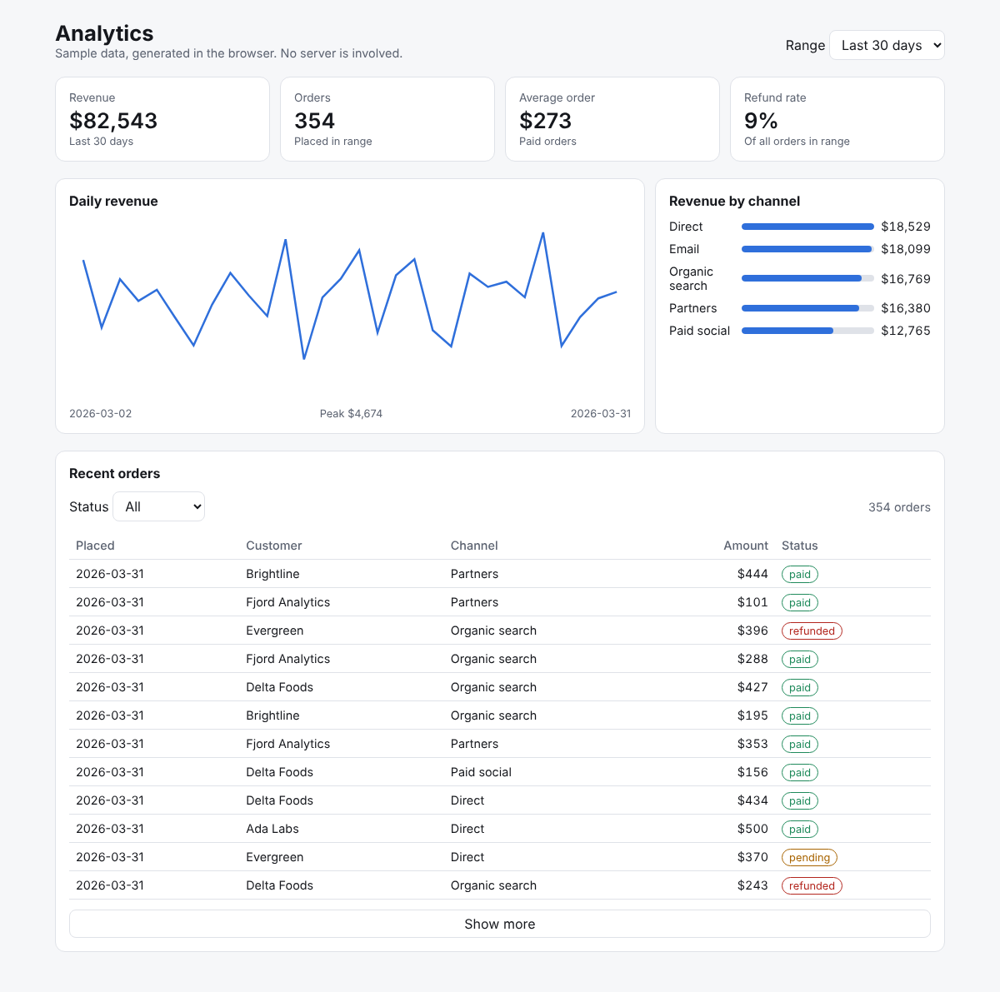
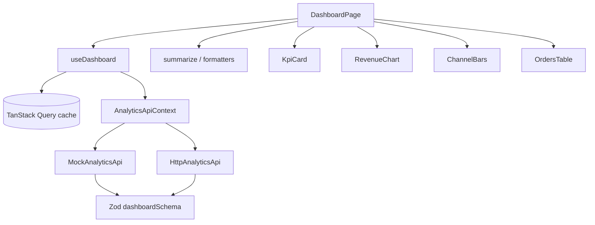

# react-analytics-dashboard

[](https://github.com/Ramvilla1997/react-analytics-dashboard/actions/workflows/ci.yml)
[](https://github.com/Ramvilla1997/react-analytics-dashboard/actions/workflows/pages.yml)

A single-page analytics dashboard built with React 19, TanStack Query, and Zod. It shows KPIs, a daily revenue chart, revenue by channel, and a filterable order table. The data comes from a mock API that is deterministic and validated, so the app runs on static hosting with no backend.



**Live demo:** https://ramvilla1997.github.io/react-analytics-dashboard/

## What it demonstrates

- **Server state with TanStack Query.** Fetching is in `useQuery` with a query key per range, a 60-second stale time, cancellation through `AbortSignal`, and a retry action on error. Components never call `fetch` directly, and `useEffect` is not used for data loading.
- **Clear layer boundaries.** `api/` defines the `AnalyticsApi` interface and two implementations (mock and HTTP). `hooks/` connects the API to components. `lib/` holds pure functions for metrics. `components/` are presentational apart from the page container.
- **Validation at the boundary.** Every dashboard payload is parsed with a Zod schema before it reaches the UI. A malformed response fails loudly instead of rendering wrong numbers.
- **Dependency injection for tests.** The API is supplied through a React context, so the page tests run against a test double with no network and no timers.
- **Accessible by default.** Charts have `role="img"` and descriptive labels. Tables have captions and scoped headers. Loading and error states use `role="status"` and `role="alert"`.

## Architecture



```
src/
  App.tsx                          providers and API selection
  main.tsx                         entry point
  styles.css                       theme tokens, light and dark
  features/analytics/
    types.ts                       Zod schemas and inferred types
    api/
      analyticsApi.ts              AnalyticsApi interface and HTTP client
      mockAnalyticsApi.ts          seeded, deterministic mock data
      AnalyticsApiContext.tsx      dependency injection
    hooks/useDashboard.ts          TanStack Query hook
    lib/summary.ts                 pure metrics and formatting
    components/                    presentational components and the page
```

## Quick start

Requires Node.js 20 or later.

```bash
npm install
npm run dev       # http://localhost:5173
npm test          # 15 tests
npm run build     # typecheck, then production build to dist/
```

The app uses the built-in mock API by default. To point it at a real backend, set `VITE_API_BASE_URL` and expect `GET {base}/analytics/dashboard?days=<7|30|90>` to return the shape defined in `types.ts`.

## Tests

| Layer | What is covered |
|-------|-----------------|
| `lib/summary.test.ts` | Revenue and order totals, average order value over paid orders only, refund rate, zero-data cases |
| `api/mockAnalyticsApi.test.ts` | Requested range length, orders filtered to the range, deterministic output, channel totals reconcile with paid orders, abort handling |
| `components/OrdersTable.test.tsx` | Newest-first ordering, status filter, live count |
| `components/DashboardPage.test.tsx` | KPIs from API data, range change triggers a new request, error state and retry recovery |

## Deployment

The `pages.yml` workflow runs the tests, builds with `VITE_BASE_PATH=/react-analytics-dashboard/`, and deploys `dist/` with the official Pages actions on every push to `main`.

GitHub Pages is set to deploy from GitHub Actions in the repository settings, so every push to `main` updates the live demo.

## Security and quality

- No secrets are needed. `.env.example` lists the only optional variables.
- CodeQL runs on every push and pull request. Dependabot checks npm and Actions weekly.
- Tests and the production build run in CI on every pull request.
- The production dependency tree has no known vulnerabilities (`npm audit --omit=dev`).

## Limitations

- The data is generated in the browser. It shows the UI and data flow, not a real business.
- The HTTP client is included and typed, but it's untested against a live server.
- Charts are hand-written SVG. That keeps the bundle small, but there are no axis ticks or tooltips. A charting library would be the next step for production use.

## License

MIT

---

More projects by Ram Villa: [github.com/Ramvilla1997](https://github.com/Ramvilla1997)
